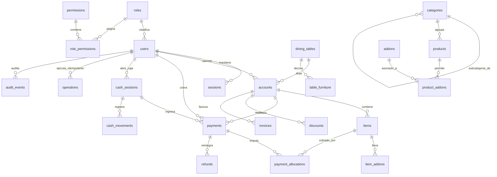

# Estructura y Arquitectura de Base de Datos

Este documento describe en detalle el modelo relacional, las tablas, restricciones de integridad, transacciones y reglas del libro contable (ledger inmutable) del sistema de gestión gastronómica.

El sistema soporta indistintamente dos motores de base de datos relacionales:
* **PostgreSQL (v14 a v18)**: Utilizado en entornos locales de desarrollo y pruebas mediante clúster embebido o contenedor Docker.
* **MySQL 8.0 / TiDB Cloud (AWS)**: Utilizado para despliegues distribuidos en la nube con compatibilidad MySQL y cifrado TLS 1.2.

---

## 1. Diagrama Entidad-Relación General



---

## 2. Módulos y Tablas del Sistema

### 2.1. Seguridad, Autenticación y Usuarios

| Tabla | Clave Primaria | Propósito | Restricciones Destacadas |
| :--- | :--- | :--- | :--- |
| `roles` | `name (text)` | Define los roles operativos: `admin`, `cashier`, `waiter`, `kitchen`, `bar`, `terminal`. | Inmutable por catálogo base. |
| `permissions` | `name (text)` | Define capacidades atómicas del sistema (`operate`, `cash`, `discount`, `refund`, `manage_catalog`, etc.). | Referenciado por `role_permissions`. |
| `role_permissions` | `(role, permission)` | Matriz de permisos asignados a cada rol. | Relación Muchos a Muchos (FK en cascada). |
| `users` | `id (uuid)` | Cuentas de empleados y perfiles del sistema. | `username UNIQUE`, `password_hash` scrypt, `pin_hash` y `pin_lookup` HMAC para terminal. |
| `sessions` | `id (uuid)` | Sesiones activas web (`management`) o terminal (`terminal`). | `token_hash UNIQUE`, expiración programada y campo `revoked_at` para invalidación inmediata. |
| `password_resets` | `id (uuid)` | Tokens temporales para restablecimiento de clave. | Un solo uso (`used_at`), expiración acotada a 15 minutos. |
| `auth_attempts` | `bucket (text)` | Registro de intentos fallidos para rate-limiting y throttling contra ataques de fuerza bruta. | Conteo en ventana temporal con bloqueo exponencial. |

### 2.2. Salón, Mesas y Plano de Planta

| Tabla | Clave Primaria | Propósito | Restricciones Destacadas |
| :--- | :--- | :--- | :--- |
| `dining_tables` | `id (uuid)` | Mesas disponibles para comensales en el salón. | `label UNIQUE` (1-30 caracteres), coordenadas espaciales `(x, y)`, `capacity (1-50)`, baja lógica (`active`). |
| `table_furniture` | `id (uuid)` | Mobiliario asociado a mesas (sillas individuales, banquetas). | Coordenadas y ángulos de giro para renderizado preciso en el plano. |
| `floor_elements` | `id (uuid)` | Elementos arquitectónicos (paredes, puertas, columnas, barras). | Geometría espacial `(x, y, width, height, rotation)` para el editor de salón. |

### 2.3. Catálogo, Productos y Variantes

| Tabla | Clave Primaria | Propósito | Restricciones Destacadas |
| :--- | :--- | :--- | :--- |
| `categories` | `id (uuid)` | Categorías principales y subcategorías de la carta. | Auto-referencia jerárquica con `parent_id`. Soporta desactivación en cascada de ramas enteras. |
| `products` | `id (uuid)` | Artículos para la venta en el salón y carta pública. | `price_cents` entero no negativo, `destination` ('kitchen', 'bar', 'none'), flags `available`, `active` y `visible_en_carta`. |
| `addons` | `id (uuid)` | Modificadores y agregados opcionales (ej: leche de almendras, shot extra). | `price_cents` exacto, control de disponibilidad independiente. |
| `product_addons` | `(product_id, addon_id)` | Asocia qué agregados aplican a qué productos. | Clave compuesta foránea. |

### 2.4. Cuentas, Pedidos y Comandas

| Tabla | Clave Primaria | Propósito | Restricciones Destacadas |
| :--- | :--- | :--- | :--- |
| `accounts` | `id (uuid)` | Cuenta de consumo asignada a una mesa ocupada. | `status` ('open', 'requested', 'closed', 'merged'), `version` para bloqueo optimista, FK `waiter_id`. |
| `items` | `id (uuid)` | Renglón de consumo dentro de una cuenta. | Máquina de estados: `draft` -> `sent` -> `preparing` -> `ready` -> `delivered` o `void`. |
| `item_addons` | `id (uuid)` | Agregados seleccionados para un ítem específico de la orden. | `price_cents` congelado al momento del pedido. |
| `order_sends` | `id (uuid)` | Lote de comanda enviado a preparación (cocina o bar). | Registra fecha, mozo emisor y tipo ('new', 'correction', 'void'). |
| `order_send_items`| `(send_id, item_id)`| Detalle de ítems incluidos en cada ticket de comanda. | `snapshot jsonb` con la descripción y notas exactas de cocina. |

### 2.5. Caja, Pagos y Facturación

| Tabla | Clave Primaria | Propósito | Restricciones Destacadas |
| :--- | :--- | :--- | :--- |
| `cash_sessions` | `id (uuid)` | Turno de apertura y cierre de caja. | **Solo 1 turno abierto simultáneamente**: índice único condicional `WHERE status='open'`. |
| `cash_movements`| `id (uuid)` | Entradas o extracciones manuales de efectivo. | Tipo 'in' o 'out', justificación obligatoria y auditoría inmutable. |
| `payments` | `id (uuid)` | Cobros aplicados a cuentas (`cash`, `debit`, `credit`, `transfer`). | Exige turno de caja abierto; cálculo exacto de vuelto (`change_cents = received - amount`). |
| `payment_allocations`| `(payment_id, item_id)`| Imputación de pagos a ítems individuales en cobros parciales. | Previene doble cobro o cobro por encima del valor del ítem. |
| `discounts` | `id (uuid)` | Bonificaciones aplicadas a la cuenta antes de pagar. | Máximo 1 descuento por cuenta, porcentaje (1-100%) o monto fijo, motivo auditado. |
| `refunds` | `id (uuid)` | Reintegro compensatorio sobre pagos ya efectuados. | Exige autorización con contraseña secundaria de encargado. |
| `invoices` | `id (uuid)` | Comprobante fiscal / ticket de demostración generado. | `document_number` único secuencial, instantánea inmutable de receptor y emisor. |

### 2.6. Auditoría e Idempotencia (Libro Inmutable)

| Tabla | Clave Primaria | Propósito | Restricciones Destacadas |
| :--- | :--- | :--- | :--- |
| `operations` | `id (uuid)` | Registro de idempotencia de comandos. | `UNIQUE(user_id, operation_key)`. Almacena `content_hash` y el JSON de respuesta para reenvíos idénticos. |
| `audit_events` | `id (uuid)` | Trazabilidad completa de cambios sensibles. | Almacena valores antes y después (`before_value`, `after_value`), motivo, usuario y marca de tiempo. |

---

## 3. Principio de Inmutabilidad Contable (Ledger)

En PostgreSQL, las tablas críticas de balances y registros contables disponen de triggers que prohíben estrictamente las sentencias `UPDATE` y `DELETE`:

```sql
CREATE FUNCTION reject_ledger_mutation() RETURNS trigger LANGUAGE plpgsql AS $$
BEGIN
    RAISE EXCEPTION 'Registro inmutable: use operación compensatoria' USING ERRCODE='23514';
END $$;

CREATE TRIGGER immutable_audit BEFORE UPDATE OR DELETE ON audit_events FOR EACH ROW EXECUTE FUNCTION reject_ledger_mutation();
CREATE TRIGGER immutable_payments BEFORE UPDATE OR DELETE ON payments FOR EACH ROW EXECUTE FUNCTION reject_ledger_mutation();
CREATE TRIGGER immutable_refunds BEFORE UPDATE OR DELETE ON refunds FOR EACH ROW EXECUTE FUNCTION reject_ledger_mutation();
CREATE TRIGGER immutable_discounts BEFORE UPDATE OR DELETE ON discounts FOR EACH ROW EXECUTE FUNCTION reject_ledger_mutation();
CREATE TRIGGER immutable_cash_movements BEFORE UPDATE OR DELETE ON cash_movements FOR EACH ROW EXECUTE FUNCTION reject_ledger_mutation();
```

*Cualquier corrección sobre un cobro, descuento o saldo debe realizarse mediante una operación compensatoria registrada (`refund.apply`, `cash.movement`), preservando la trazabilidad financiera.*

---

## 4. Reglas de Concurrencia y Bloqueos

1. **Advisory Locks Transaccionales**:
   Toda transacción de escritura a través del despachador central (`transaction(..., write = true)`) adquiere un bloqueo serializado en memoria (`pg_advisory_xact_lock(725615870)` en PostgreSQL o `GET_LOCK('gestion_cafe_xact')` en MySQL). Esto impide condiciones de carrera al numerar facturas, cobrar saldos simultáneos o cambiar estados de turnos de caja.
2. **Control Optimista de Versiones**:
   La tabla `accounts` incluye la columna `version integer NOT NULL DEFAULT 1`. Si dos clientes intentan modificar una cuenta simultáneamente, la cláusula `WHERE id = $1 AND version = $2` detecta el conflicto y fuerza a reconsultar el estado antes de aplicar cambios.

